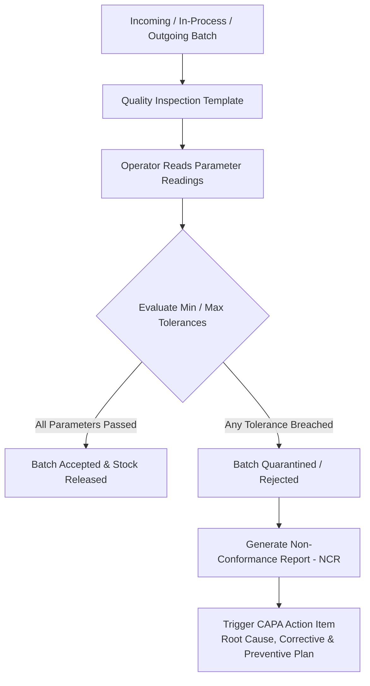

# Frappe Quality Assurance & CAPA Engine (Inspections & Corrective Actions)

[](https://www.python.org/)
[](https://frappe.io)
[]()
[](LICENSE)
[]()

> **"Quality inspections, corrective actions aur quality reports"**  
> Complete enterprise quality management and compliance engine for Frappe & ERPNext supporting incoming raw material inspections, in-process routing quality, non-conformance reports (NCR), and Corrective & Preventive Actions (CAPA).

---

## 🎯 The Real-World Client Problem & Business Context

Manufacturing plants and life-sciences businesses face severe customer rejections when quality controls are weak:
1. **Defective Raw Materials Entering Assembly:** Sub-standard supplier materials pass into production undetected, resulting in high scrap rates and wasted machining hours.
2. **Untracked Non-Conformance (NCR):** Quality deviations on the factory floor are resolved ad-hoc without formal root-cause analysis or corrective action plans.
3. **Audit Failures during ISO / FDA Certifications:** Companies fail regulatory audits because there is no tamper-proof digital paper trail linking rejected batches to supplier corrective actions.

**This engine automates standard ERPNext quality workflows:** Evaluating dimensional and chemical tolerances against min/max thresholds, rejecting out-of-spec batches, and triggering automated CAPA investigation tickets.

---

## 🏗️ Quality Management & CAPA Workflow Flow



---

## ⚙️ Key Enterprise Features & Capabilities

- **Quality Inspection Templates:** Define quantitative criteria (dimensions, tensile strength, purity %) and qualitative criteria (surface finish, color).
- **Tolerance Range Validation:** Validates physical readings against minimum and maximum acceptable engineering tolerances.
- **Automated Quarantine Routing:** Automatically diverts failed batches to rejection warehouses, preventing defective items from being delivered.
- **Corrective & Preventive Action (CAPA):** Implements standard ISO 9001 8D methodology: root-cause identification, corrective action, preventive action, and verification.
- **Quality Performance Analytics:** Track supplier rejection rates (PPM - Parts Per Million) and workstation non-conformance frequencies.

---

## 📂 Repository & Module Structure

```
frappe-quality-assurance-capa-engine/
├── quality_capa/
│   ├── __init__.py           # Package version & module exports
│   └── engine.py             # Quality inspection & tolerance evaluation engine
├── tests/
│   ├── __init__.py
│   └── test_quality_capa.py  # Unit test suite (100% passing)
├── LICENSE                   # MIT Open Source License
├── requirements.txt          # Python dependencies
└── README.md                 # Complete documentation
```

---

## 💻 Production Usage Example

```python
from quality_capa.engine import (
    FrappeQualityAssuranceEngine, InspectionParameter
)

engine = FrappeQualityAssuranceEngine()

# 1. Define inspection parameters with engineering tolerances
parameters = [
    InspectionParameter("Shaft Diameter (mm)", target_value=25.0, min_acceptable_value=24.8, max_acceptable_value=25.2, reading_value=25.08),
    InspectionParameter("Surface Hardness (HRC)", target_value=45.0, min_acceptable_value=42.0, max_acceptable_value=48.0, reading_value=44.5),
    InspectionParameter("Material Purity (%)", target_value=99.8, min_acceptable_value=99.5, max_acceptable_value=100.0, reading_value=98.9) # Failed!
]

# 2. Execute automated quality inspection
report = engine.evaluate_inspection("INSP-2026-0042", "FG-PISTON-ROD", "BATCH-901", parameters)
print(f"Overall Inspection Verdict: {report.overall_status}")  # REJECTED
for fail in report.failed_parameters:
    print(f"Failed Parameter Flagged: {fail}")
```

---

## 🧪 Testing & Verification

Run tests with standard Python:
```bash
python3 -m unittest discover tests
```

---

## 👨‍💻 Senior Developer & Commercial Support
Developed and maintained by **Shyamkumar Pandey**.  
For ISO 9001/14001 compliance, factory quality digitizations, and custom ERPNext inspections:
- **GitHub:** [@shyampandey1104](https://github.com/shyampandey1104)
- **Email:** [shyampandey1104@gmail.com](mailto:shyampandey1104@gmail.com)
